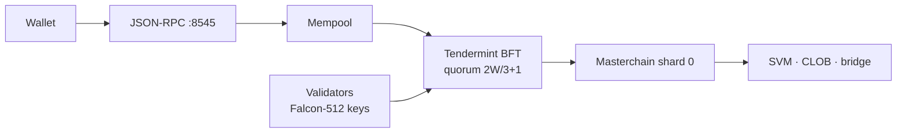

<p align="center">
  
  
</p>

<h1 align="center">Stellereum Network</h1>

<p align="center">
  <strong>Post-quantum Layer-1 blockchain, rebuilt in pure Rust.</strong><br/>
  Tendermint-style BFT, Falcon-512 signatures, actor accounts, on-chain order book —<br/>
  a full node on lightweight hardware. Open source, quantum-safe, and yours.
</p>

<p align="center">
  <a href="https://github.com/stellereum/stellereum/actions/workflows/ci.yml"></a>
  <a href="LICENSE-MIT"></a>
  <br/>
  
  
</p>

## Highlights

- Post-quantum always-on (FULL-PQ): the node binary forces pure-PQ at
  startup (`src/main.rs:2849` pins `set_pure_pq_override(Some(true))`), so
  only PQ schemes (Falcon-512 and Hybrid PQ1 envelopes) are admitted
  chain-wide — classical Ed25519 is refused at intake (`src/rpc.rs:3768`).
  `STELL_PURE_PQ` / `--pure-pq` are dead operator-compat knobs:
  parsed-and-ignored with a loud WARN, never a gate (M-01 closed by the
  FULL-PQ cut).
- 0.6 s block target with ~11 ms of measured CPU per block height
  (classical path; PQ-path figures are projected, not measured —
  see `docs/PERF_1K.md`)
- Native CLOB order book, bridge and oracle on-chain — no external DeFi needed
- Runs a validator on 1 vCPU: no datacenter hardware required

## The STELL token

- **Gas**: every transaction pays fees in STELL (floor-aware estimates)
- **Staking**: bond STELL to validate or delegate; rewards accrue per epoch
- **Security budget**: 5% equivocation slash and 0.1% downtime slash are denominated in STELL
- Testnet STELL has no value — faucet coins are for testing only

## Quickstart

```bash
git clone https://github.com/stellereum/stellereum.git && cd stellereum
cargo build && ./target/debug/stellereum sim --blocks 3   # full stack in-process
```

Wallet, node and validator flows: [`VALIDATOR.md`](VALIDATOR.md),
[`NODE.md`](NODE.md), [`testnet/README.md`](testnet/README.md).

## How it fits together



Single shard is canonical today; workchain paths are parked behind a boot
guard. Details: [`PROTOCOL.md`](PROTOCOL.md).

## Features

### Consensus that finalizes in one height

Propose → prevote → precommit → commit with Tendermint-style value locking.
Quorum is `floor(2W/3)+1` of voting power, counted over verified genuine
signers only; empty validator sets fail closed. Symbolic round/timeout ladder
with deterministic backoff, deadlock breakers and straggler grace keep liveness
under slow and flapping proposers — all pinned by simulation batteries
(`consensus_byzantine_tests`, `liveness_breaker_tests`, `chaos_n4_tests`).

### Post-quantum signatures everywhere it counts

Validator votes, blocks and handshakes verify under Falcon-512 (FIPS 206);
classical Ed25519/BLS/ECVRF code paths are refused chain-wide — the
chain never counts a classical signature. The node runs pure-PQ always-on
(see above); there is no dual-stack mode. Validator PQ keys live in an
on-chain registry with rotation delays, queryable over RPC (`stell_getPqKey`).

### Execution: SVM, order book, bridge, oracle

Accounts, tokens (STS-20), on-chain DNS, liquidity pools, a central-limit
order book with price-time priority, a primary-market-maker exchange, price
oracles with TWAP fallback, and a governed bridge with timelocked withdrawals —
all running in the SVM — Stellereum Virtual Machine, our own metered contract
runtime. An EVM adapter answers `eth_*` RPC for tooling compatibility.

### Staking operators actually get

Bond, delegate and redelegate without full unbond waits; bounded mutable
commission with exit windows; automatic jailing on downtime with an `unjail`
return path; bare-minimum ejection protection; 5% equivocation slash and 0.1%
downtime slash proven by drill tests. Unbonding and rotation delays are
consensus constants — identical on every node.

### Sync and storage operators can trust

Snapshot + verifiable walks with per-height validator-set binding, strict
snapshot parsing (legacy blobs refused), crash-consistency batteries (torn
writes, interrupted drains, bit-flip storms all fail closed), restore
performance measured (10k accounts in under a second).

### Light clients and wallets

Validator-set rotation with old-quorum-signed rotation points, third-party
verify-from-genesis recipe, CLI (`light-anchor` / `light-verify` /
`light-rotate`). Wallet: offline signing, stealth addresses, session keys,
PQ-first keyfiles, chain-id-bound envelopes against replay.

## Requirements

| Role | CPU / RAM / Disk |
| :--- | :--- |
| Full node / observer | 1 vCPU · 2 GB RAM · 20 GB disk |
| Validator | 1 vCPU · 2 GB RAM · 20 GB disk (same box class) |

Prune mode keeps the last 1,000,000 blocks by default; archive nodes grow
without bound. Full table and rationale: [`NODE.md`](NODE.md).

## Testing

| Suite | Scope | Run it |
| :--- | :--- | :--- |
| Library unit tests | 1088 passed, 0 failed | `cargo test -p stellereum --lib` |
| Feature matrix | 113 rows: 112 green, 1 intentional skip | `./scripts/feature_matrix.sh` |
| Fuzz decode harnesses | 7 targets + fixed-seed economics batteries | `cargo test --test fuzz_economics_ext` |
| Simulation batteries | byzantine, chaos-N4, slash drills, tempo, liveness horizons | `cargo test --test chaos_n4_tests`, … |
| Pentest batteries | mempool/DoS, WS/faucet, RPC surface, P2P eclipse, MEV, privacy gates | `cargo test --test pentest_*` |
| Audit repro | every audit claim re-executed from scratch | `stellereum/scripts/audit-repro.sh` |

Counts measured 2026-11-04; re-run to refresh. Lints are law:
`cargo clippy --all-targets -- -D warnings` must be clean.

## Repositories

- [`infnode`](https://github.com/stellereum/infnode) — QUIC+DHT transport,
  reputation with bans, backpressure caps, ML-KEM sessions
- [`stellereum-contracts`](https://github.com/stellereum/stellereum-contracts) — STS-20,
  DNS, pools, account objects + e2e and adversarial suites
- [`stellereum-indexer`](https://github.com/stellereum/stellereum-indexer) — chain
  indexer with REST API over SQLite WAL
- [`stellereum-sdk`](https://github.com/stellereum/stellereum-sdk) — canonical
  transaction-builder SDK (output matches consensus encoding by construction)

## Status

Closed local-only testnet, no production network. Protocol freeze decisions
(single shard, PQ-only, retired VRF arming, H-gated classical sunset) are
recorded in [`docs/program/PUBLIC_TESTNET_CODE_GAPS.md`](docs/program/PUBLIC_TESTNET_CODE_GAPS.md).
Coverage is tracked in [`docs/program/FEATURES.md`](docs/program/FEATURES.md).

## Security

Internal audits live in [`docs/audits/`](docs/audits/) (protocol, consensus,
mempool/P2P, PQ crypto, staking/economics, storage/sync, bridge/privacy,
RPC/EVM pentests + unified [`docs/program/PENTEST_SUMMARY.md`](docs/program/PENTEST_SUMMARY.md));
external audit is pending. Testnet coins have no value. **Never open a public
issue for a suspected vulnerability** — report via [`SECURITY.md`](SECURITY.md).

## Contributing · License

Open an issue with a reproducer before large PRs; keep `cargo test --lib`
green. MIT **or** Apache-2.0 ([`LICENSE-MIT`](LICENSE-MIT),
[`LICENSE-APACHE`](LICENSE-APACHE)).
Entry docs: [`PROTOCOL.md`](PROTOCOL.md) · [`docs/OPERATIONS.md`](docs/OPERATIONS.md) ·
[`docs/RPC.md`](docs/RPC.md) · [`NODE.md`](NODE.md) · [`VALIDATOR.md`](VALIDATOR.md).
