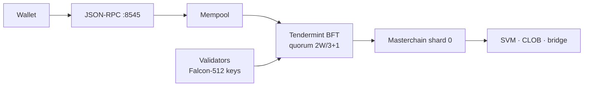

# Stellereum Network (STELL)

> Testnet software — no real funds, no mainnet yet, no external audit yet.

A post-quantum Layer-1 blockchain in Rust: Tendermint-style BFT finality,
Falcon-512 validator signatures, actor accounts, a native on-chain order book —
running on lightweight hardware. `chainId 5757`.

## Highlights

- Post-quantum by default: Falcon-512 signatures enforced, classical crypto refused
- 0.6 s block target with ~11 ms of measured CPU per block height
- Native CLOB order book, bridge and oracle on-chain — no external DeFi needed
- Runs a validator on 1 vCPU: no datacenter hardware required

<p align="center">
  <a href="https://github.com/stellereum/stellereum/actions/workflows/ci.yml"></a>
  <a href="LICENSE-MIT"></a>
  
</p>

## Quickstart

```bash
git clone https://github.com/stellereum/stellereum.git && cd stellereum
cargo build                                   # 1. build the node
./target/debug/stellereum wallet generate     # 2. fresh keypair + stealth address
./target/debug/stellereum wallet address --from-key <PRIVATE_KEY>  # 3. re-derive address
# 4. sign a transfer OFFLINE (no node needed; --nonce skips the RPC lookup)
./target/debug/stellereum wallet send --from-key <PRIVATE_KEY> --to <ADDR> --amount 1000000000 --nonce 0 --dry-run
./target/debug/stellereum sim --blocks 3      # 5. full stack in-process: BFT + CLOB + bridge
```

Want to run a node or validate? Start with [`NODE.md`](NODE.md) and
[`VALIDATOR.md`](VALIDATOR.md). Multi-node stands: [`testnet/README.md`](testnet/README.md).

## How it fits together

## How it fits together



Single shard is canonical today; workchain code paths are parked behind a
boot guard. Details live in [`PROTOCOL.md`](PROTOCOL.md) and
[`docs/program/PUBLIC_TESTNET_CODE_GAPS.md`](docs/program/PUBLIC_TESTNET_CODE_GAPS.md).

## Repositories

- [`stellereum`](https://github.com/stellereum/stellereum) — this repo: the node
- [`infnode`](https://github.com/stellereum/infnode) — QUIC+DHT transport
- [`stellereum-contracts`](https://github.com/stellereum/stellereum-contracts) — on-chain programs
- [`stellereum-indexer`](https://github.com/stellereum/stellereum-indexer) — chain indexer
- [`stellereum-sdk`](https://github.com/stellereum/stellereum-sdk) — Rust SDK
- [`stell-wallet`](https://github.com/immtes/stell-wallet) — CLI wallet (publishing soon)

## Status

Closed local-only testnet: simulator and deterministic devnet work, multi-node
configs ship in `testnet/`. There is no production network. Test coverage
is tracked in [`docs/program/FEATURES.md`](docs/program/FEATURES.md).

## Security

Internal audit program (protocol, consensus, mempool/P2P, PQ crypto,
staking/economics, storage/sync, bridge/privacy, RPC/EVM pentests) lives in
[`docs/audits/`](docs/audits/). External audit is pending. Testnet coins have
no value. **Never open a public issue for a suspected vulnerability** — report
via [`SECURITY.md`](SECURITY.md).

## Contributing · License

No formal process yet — open an issue with a reproducer before large PRs and
keep `cargo test --lib` green. License: MIT **or** Apache-2.0
([`LICENSE-MIT`](LICENSE-MIT), [`LICENSE-APACHE`](LICENSE-APACHE)).
Entry docs: [`PROTOCOL.md`](PROTOCOL.md) · [`docs/OPERATIONS.md`](docs/OPERATIONS.md) ·
[`docs/RPC.md`](docs/RPC.md) · [`NODE.md`](NODE.md) · [`VALIDATOR.md`](VALIDATOR.md).
