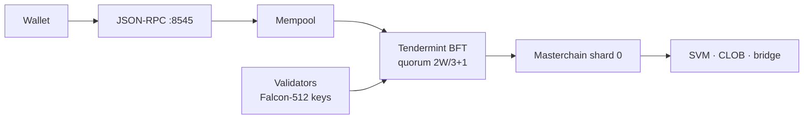

# Stellereum Network (STELL)

> Testnet software — no real funds, no mainnet yet, no external audit yet.

A post-quantum Layer-1 blockchain in Rust: Tendermint-style BFT finality,
Falcon-512 validator signatures, actor accounts, a native on-chain order book —
running on lightweight hardware. `chainId 5757`.

<p align="center">
  <a href="https://github.com/stellereum/stellereum/actions/workflows/ci.yml"></a>
  <a href="LICENSE-MIT"></a>
  
</p>

## Highlights

- Post-quantum by default: Falcon-512 signatures enforced, classical crypto refused
- 0.6 s block target with ~11 ms of measured CPU per block height
- Native CLOB order book, bridge and oracle on-chain — no external DeFi needed
- Runs a validator on 1 vCPU: no datacenter hardware required

## Quickstart

```bash
git clone https://github.com/stellereum/stellereum.git && cd stellereum
cargo build && ./target/debug/stellereum sim --blocks 3   # full stack in-process
```

Wallet, node and validator flows: [`VALIDATOR.md`](VALIDATOR.md),
[`NODE.md`](NODE.md), [`testnet/README.md`](testnet/README.md).

## How it fits together



Single shard is canonical today; workchain paths are parked behind a boot
guard. Details: [`PROTOCOL.md`](PROTOCOL.md).

## Repositories

- [`infnode`](https://github.com/stellereum/infnode) — QUIC+DHT transport
- [`stellereum-contracts`](https://github.com/stellereum/stellereum-contracts) — on-chain programs
- [`stellereum-indexer`](https://github.com/stellereum/stellereum-indexer) — chain indexer
- [`stellereum-sdk`](https://github.com/stellereum/stellereum-sdk) — Rust SDK

## Status

Closed local-only testnet, no production network. Coverage is tracked in
[`docs/program/FEATURES.md`](docs/program/FEATURES.md).

## Security

Internal audits live in [`docs/audits/`](docs/audits/); external audit is
pending. Testnet coins have no value. **Never open a public issue for a
suspected vulnerability** — report via [`SECURITY.md`](SECURITY.md).

## Contributing · License

Open an issue with a reproducer before large PRs; keep `cargo test --lib`
green. MIT **or** Apache-2.0 ([`LICENSE-MIT`](LICENSE-MIT),
[`LICENSE-APACHE`](LICENSE-APACHE)).
